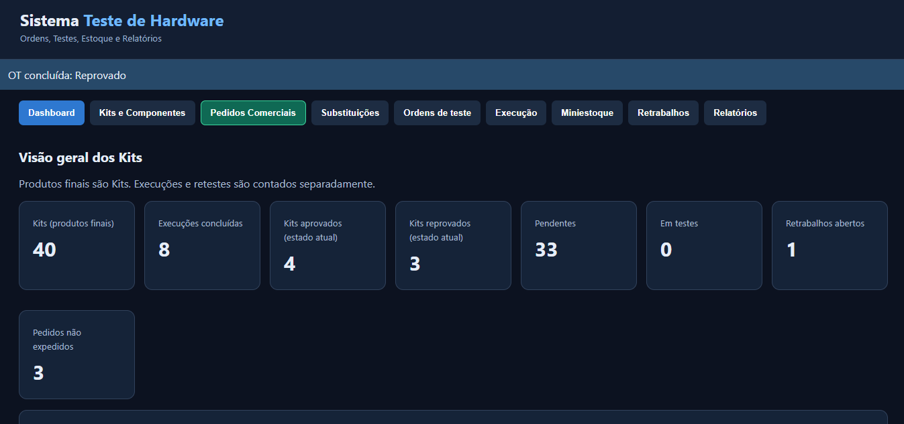
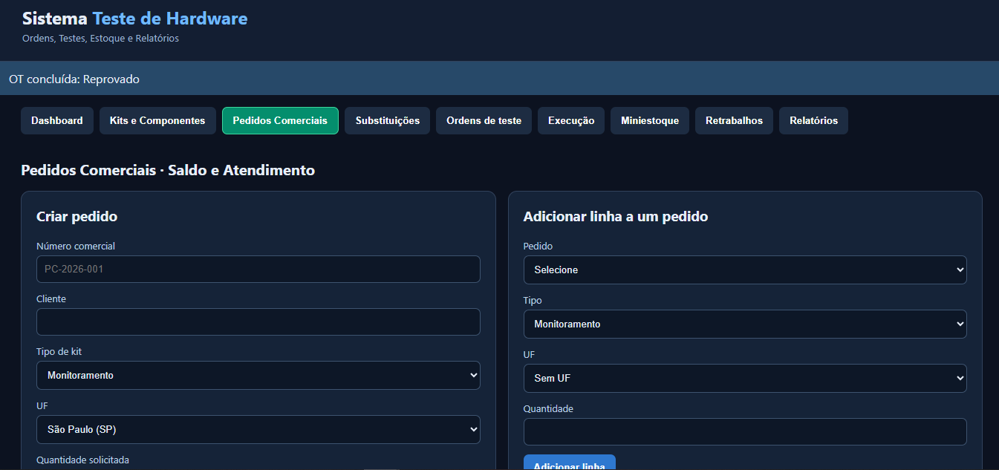
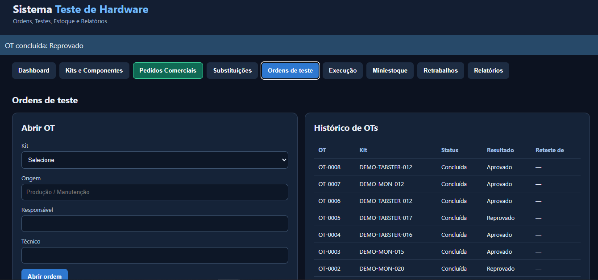
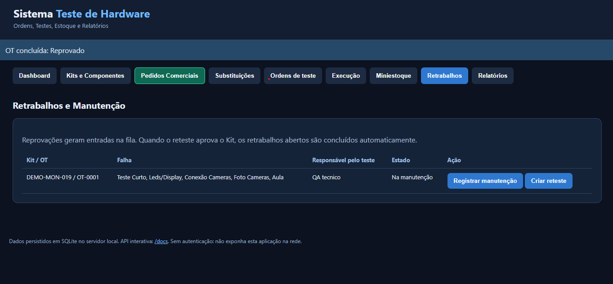

# TestFlow — Sistema Teste de Hardware (v0.5)

**Projeto pessoal de software para gestão de testes de hardware**, desenvolvido para organizar e acompanhar o fluxo de testes de equipamentos eletrônicos. Aplicação web executável localmente no Windows.

## Funcionalidades

- **Produtos finais:** Kits Monitoramento e TABSTER, com componentes associados e histórico de patrimônio e ID/serial.
- **Ordens de teste:** checklists por tipo de Kit, resultados, operador responsável e retestes.
- **Pedidos comerciais:** múltiplos Kits por pedido, UF de destino, saldo estimado e alocação progressiva, distinguindo disponibilidade e liberação após aprovação.
- **Dashboard:** total de Kits separado das execuções de testes. A aprovação/reprovação de cada Kit reflete seu estado atual, sem somar retestes como produtos diferentes.
- **Retrabalhos:** acompanhamento de reprovações e manutenções, retestes e histórico de substituição de componentes.
- **Relatórios:** consulta operacional e geração de resumo semanal em PDF, sob demanda.

## Demonstração visual

Capturas da interface do TestFlow v0.5, utilizando registros demonstrativos.

### Dashboard de Kits

O total de produtos finais considera **Kits**, enquanto execuções e retestes são contabilizados separadamente.



### Pedidos comerciais

Cadastro de pedidos por tipo de Kit e UF de destino, com controle de quantidade solicitada e acompanhamento do atendimento.



### Ordens de teste

Abertura de OTs e consulta ao histórico, com Kits, resultados e identificação do responsável.



### Retrabalhos e manutenção

Acompanhamento de reprovações e disponibilização das ações de manutenção e reteste.



## Tecnologias

Python · FastAPI · SQLite · JavaScript · HTML · CSS · APIs REST · Git

## Executar no Windows

Com Python instalado, abra `INICIAR_TESTFLOW.cmd` ou execute:

```powershell
py -m venv .venv
.\.venv\Scripts\python.exe -m pip install -r requirements.txt
.\.venv\Scripts\python.exe -m uvicorn app:app --host 127.0.0.1 --port 8000
```

Abra `http://127.0.0.1:8000`. O banco SQLite local é criado ao iniciar a aplicação. Este repositório não contém registros privados nem banco demonstrativo pré-carregado.

## Autoria e observações técnicas

O projeto foi especificado e validado funcionalmente por seu autor, com **implementação assistida por inteligência artificial**. A geração de PDF semanal é acionada pelo usuário no sistema. O projeto não inclui integração direta com hardware nem agendamento automático de relatórios.

**Privacidade:** use apenas dados fictícios ao demonstrar; não publique bancos SQLite, arquivos `.env`, segredos ou informações internas de empresa/clientes.
